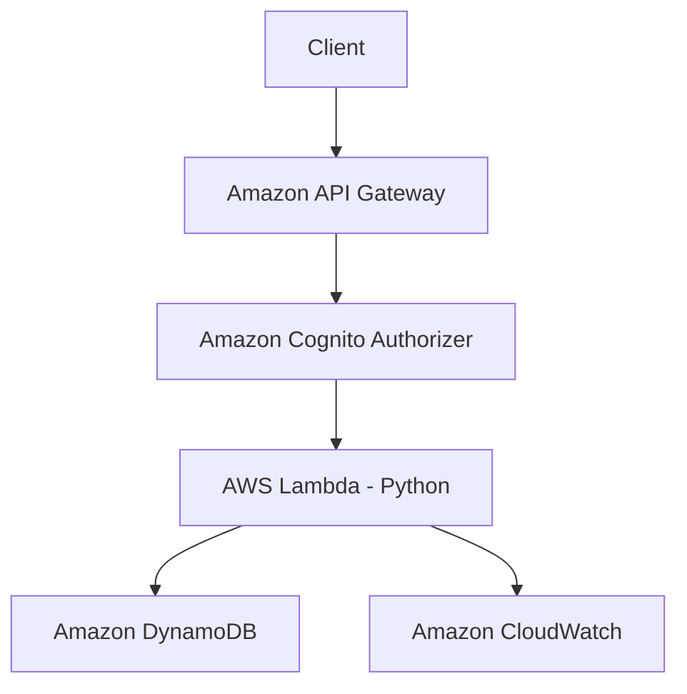

# CloudTask – Serverless Task Management API

A serverless REST API for managing personal tasks, built using AWS services and Python. Supports authenticated task management with user-level data isolation.

## Features

- Create, retrieve, update and delete tasks.
- JWT-based authentication using Amazon Cognito.
- User-specific task access and data isolation.
- Input validation and structured error handling.
- Serverless deployment using AWS SAM.

## Architecture



## Tech Stack

| Component | Technology |
|---|---|
| Language | Python 3.14 |
| API | Amazon API Gateway |
| Compute | AWS Lambda |
| Database | Amazon DynamoDB |
| Authentication | Amazon Cognito |
| Infrastructure | AWS SAM / CloudFormation |
| Monitoring | Amazon CloudWatch |
| Testing | Pytest, DynamoDB Local |

## API Endpoints

| Method | Endpoint | Description |
|---|---|---|
| GET | `/health` | Health check |
| POST | `/tasks` | Create a task |
| GET | `/tasks` | List user tasks |
| GET | `/tasks/{task_id}` | Retrieve a task |
| PUT | `/tasks/{task_id}` | Update a task |
| DELETE | `/tasks/{task_id}` | Delete a task |

Task operations require a valid Cognito JWT. Each task is scoped to its authenticated user.

## Local Setup

Prerequisites: Python, AWS SAM CLI, AWS CLI and Docker.

```powershell
python -m venv .venv
.\.venv\Scripts\Activate.ps1
pip install -r hello_world/requirements.txt
pip install -r tests/requirements.txt

sam build
python -m pytest tests/ -v
```

## Deployment

Configure AWS credentials and your preferred AWS region, then run:

```powershell
sam build
sam deploy --guided
```

For subsequent deployments:

```powershell
sam build
sam deploy
```

The API endpoint and resource identifiers are available in the CloudFormation stack outputs.

## Testing & Security

Verified through local and deployed API testing:

- Task CRUD operations.
- Cognito authentication.
- Rejection of unauthenticated requests (`401`).
- User-level data isolation between two Cognito users.
- Invalid status and oversized title rejection (`400`).
- Malformed JSON handling (`400`).
- Lambda CloudWatch log inspection.

## Cost Considerations

Uses serverless, on-demand AWS resources. Actual charges depend on usage, account eligibility and applicable AWS pricing. Monitor AWS Budgets and Cost Explorer.

## Cleanup

To remove the deployed application:

```powershell
sam delete --stack-name cloudtask
```

**Warning:** This removes the deployed stack and its resources, including the task database. Back up any data you need before deletion.